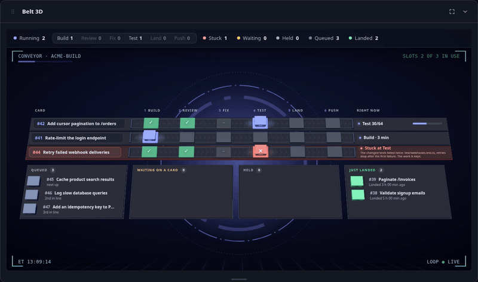

# Conveyor

Conveyor turns your GitHub issues into reviewed, tested commits on your default branch.

<p align="center"><picture><source media="(prefers-color-scheme: dark)" srcset="docs/brand-dark.svg"></picture><br>
   <a href="LICENSE"></a> <a href="https://github.com/pushprove-max/conveyor-belt/stargazers"></a></p>

<p align="center"><br>
<a href="docs/demo.mp4">The same demo as an MP4, sharper</a></p>

Conveyor is a Claude Code plugin that turns GitHub issues into merged commits, one card per issue. Conveyor builds
each card in a fresh git worktree. A second model reviews it, a fix session fixes what the review finds, and the
card's tests run. Then Conveyor lands one commit on your default branch. It pushes when you press "Push landed" on the
Board, or on its own once you turn push on in the Rules tab. A card that needs a person waits for you, and the other
cards go on.

<p align="center"></p>

<p align="center"></p>

## Requirements

A default setup needs macOS or Linux, bash 5.1 or newer, jq 1.8 or newer, git, `flock`, Python 3, the GitHub CLI (`gh`, signed
in), the Claude Code CLI and the Codex CLI. On Debian or Ubuntu, Python 3 also needs `python3-venv`. The Codex CLI
runs the default reviewer. Without it, the reviewer runs on Claude. If you set your own `models.allowed` in
`.conveyor/project.json`, remove its `codex` models, then run `/conveyor-belt:setup` again. Conveyor runs its
sessions in Claude Code, Codex or OpenCode.
`/conveyor-belt:setup` installs each one that is missing or too old. [Setup](docs/setup.md#requirements) lists each
requirement with its minimum version.

## Install

```
/plugin marketplace add pushprove-max/conveyor-belt
/plugin install conveyor-belt@conveyor-belt
```

## Set up

In Claude Code, in your project's checkout, run `/conveyor-belt:setup`. It asks who approves a change that users will
see, where the product code is and the command that runs the tests. Then it installs the newest release of Conveyor
and saves its settings: the project's settings in `.conveyor/project.json`, and this machine's settings in your home
folder. It gives the command that commits `.conveyor/project.json`. Commit that file on your default branch. Last,
setup runs doctor, which checks the setup ([Setup](docs/setup.md#setup)).

## The test map

The test map tells which test files cover which source files. Setup makes it with the coverage tool of your language.
With the map, a card runs only the tests that cover its change, not the whole suite. The test step of each card is
then much faster. Answer yes when setup offers to make the map. The first map needs one whole run of your suite, and
setup is the time for that run. To make the map later, run `/conveyor-belt:setup` again. After that, the map stays
current by itself. A whole run on main makes it again when it is due. A card adds the test files that it adds.
`/units` shows how far the run is, and then the state of the map
([The test map](docs/configuration.md#the-test-map)).

## Start

Setup's last question is "Start Conveyor now as this machine's service?". To start it later, run
`/conveyor-belt:setup` again in your project's checkout and answer yes ([Run](docs/setup.md#run)).

## The Board

The Board is a local web page that shows the belt: what needs you, the cards and their steps, what landed and what
each card cost. Its Rules tab holds the settings, such as how many cards run at once and which model builds, reviews
and judges ([how to install it](docs/board.md#install-the-board)).

## Tests

Conveyor measures the CPU time of each test file on every card. It keeps a budget for each file and one for the
project, and it finds the files that got slower or that are flaky. Its test rules can file an issue for such a file.
On the Board's Tests page, you can ask a model to judge if a test checks what it should, or to explain why a file got
slower ([Tests page](docs/board.md#tests-page)).

## /units

`/units` shows the belt inside Claude Code: what needs you, the cards on the belt and their steps, the queue and what
landed today. It also shows the belt in a band above the prompt, a side pane and the status line. It comes with the
plugin, so there is nothing more to install ([/units](docs/units.md)).

## Foreman

The Foreman is a Claude Code session in your project's main checkout. It brings you blocked cards, changes that wait
for your yes and push errors. Set it up with `/conveyor-belt:setup --foreman` ([Foreman](docs/foreman.md)).

## More

[Setup](docs/setup.md) · [How a card goes](docs/cards.md) · [Commands](docs/commands.md) · [Configuration](docs/configuration.md) ·
[The Board](docs/board.md) · [Foreman](docs/foreman.md) · [Lanes](docs/lanes.md) · [/units](docs/units.md) ·
[Releases](docs/releases.md) · [Benchmarks](docs/benchmarks.md) · [Credits](docs/credits.md) ·
[Contributing](CONTRIBUTING.md) · [Code of conduct](CODE_OF_CONDUCT.md) · [Security policy](SECURITY.md)

## License

Apache-2.0. See [LICENSE](LICENSE) and [NOTICE](NOTICE).
